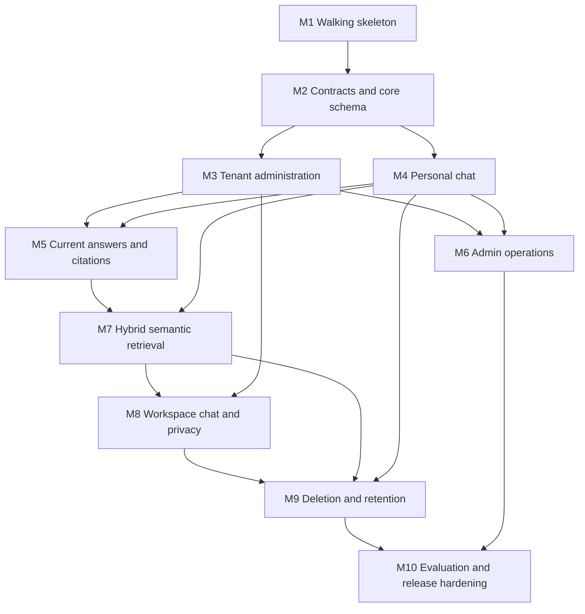

# Momos Implementation Plan

This plan turns [`SPEC.md`](SPEC.md) and [`DESIGN.md`](DESIGN.md) into deployable vertical increments. It treats the privacy rule for team context as a hard contract: context sent to the model contains only message content and timestamp; identities, role, conversation/message IDs, and scope metadata are used server-side only and are stripped before model/tool/output boundaries.

## Planning rules and shared definition of done

- Waves run in order. Milestones in one wave may run together only where this plan names them as parallel-safe and their owned paths/tables are disjoint.
- Every change remains deployable with expand/contract migrations, feature flags where a capability is incomplete, backwards-compatible APIs, and no credentials in source control.
- Tests are written first. Endpoint tests cover success, invalid input, unauthenticated access, wrong role, and cross-tenant access where applicable. Integration tests use real PostgreSQL (and a real vector service in M7 onward); no database mocks.
- Each milestone runs typecheck, lint, format check, relevant unit/integration/security tests, and a production build. Update the relevant docs and deploy to the shared staging environment. Done means the capability can be demonstrated there, the migration/deployment is repeatable, and its rollback/degraded behavior is documented.
- **ASSUMPTION:** “Independently shippable” means each milestone can be deployed to staging and demonstrated without unfinished later milestones; incomplete product capabilities remain disabled or clearly labelled until their required milestone lands.
- Each milestone owns only the paths, routes, and tables listed below. Shared files, types, route registration, migrations, and contracts are owned by M1/M2 and are changed later only through a sequential contract/migration milestone.

## Milestones

### M1 — Walking skeleton

- **Goal:** A minimal Momos service is built by CI, connected to PostgreSQL, authenticated through OIDC, health checked, and deployed to staging.
- **Features:** Establish repository conventions and TypeScript/Node runtime; CI checks and deployment pipeline; staging configuration/secrets injection; PostgreSQL connection and migration runner with initial identity/session migration; `/health/live` and `/health/ready`; vendor-independent OIDC authorization-code flow with PKCE/state/nonce and secure session cookie; request IDs, structured content-free logs, baseline metrics/tracing, security headers, TLS, and sign-in rate limit. Deploy the empty authenticated shell and demonstrate sign-in plus health checks.
- **Tests:** CI clean build; migration from empty database; OIDC state/nonce/PKCE and unauthenticated behavior; secure cookie/CSRF baseline; health behavior with database available/unavailable; secrets and message content absent from logs; staging deploy and rollback smoke check.
- **Done means:** CI/CD repeatedly deploys the authenticated shell; migration is backward-compatible and repeatable; health, auth, logging, and security checks pass; staging sign-in and readiness are demonstrated.
- **Depends on:** None.
- **Wave:** 1.
- **Parallel-safe with:** none.
- **Owns:** Repository/bootstrap configuration, package/build configuration, `.github/workflows/**`, `infra/staging/**`, `.env.example`, `src/app.ts`, `src/db/connection/**`, `src/db/migration-runner/**`, the exact migration file `src/db/migrations/0001_identity_session.*`, `src/modules/health/**`, `src/modules/auth/**`, `src/observability/**` baseline, and their tests. Owns `Person`, `AuthIdentity`, and `Session` tables.
- **Contracts consumed / produced:** Consumes selected runtime/hosting secrets supplied for staging. Produces the deployable service, auth actor/session primitive, request ID/logging/health conventions, migration runner, CI quality gates, and deployment interface. No product API or tenant-role contract yet.

### M2 — Shared contracts and core schema

- **Goal:** All shared product contracts and the complete first-release relational schema are finalized, migrated, and deployed before feature work splits.
- **Features:** Freeze `/api/v1` JSON request/response schemas for chat, history, deletion, tenancy/admin, and health; stable error envelope, cursor format, idempotency behavior, validation boundary, role matrix, trusted actor/tenant context, route-module registration, and provider ports for model, web search, embedding, vector store, metrics, and audit events. Define all core tables, constraints, indexes, audit/rate-limit event fields, idempotency records, and PostgreSQL embedding outbox in one backward-compatible core migration. Define vector metadata/filter contract (scope/status/timestamp only; never model context) without choosing a vendor. Record OpenAPI/schema source and data dictionary.
- **Tests:** Contract/schema validation fixtures; error/status consistency; cursor tampering/scope binding; role matrix unit tests; migration-upgrade tests from M1 schema; index/constraint checks; prove client-supplied role/company/workspace cannot become authority; prove context DTO cannot represent identity/role/IDs/scope fields.
- **Done means:** Contract and schema changes are merged before any feature agent starts; staging migration passes on a copy of M1 data; generated/shared types are stable; API and database contracts are documented and demonstrable through schema/contract validation.
- **Depends on:** M1.
- **Wave:** 2.
- **Parallel-safe with:** none.
- **Owns:** `src/contracts/**`, `src/shared/api-errors/**`, `src/shared/authz-contracts/**`, `src/shared/validation/**`, `src/shared/route-registration/**`, `src/shared/providers/contracts/**`, `docs/api/**`, `docs/data-model.md`, and one sequential `src/db/migrations/0002_core_schema.*`. Owns schema definitions for `Company`, `CompanyMembership`, `Workspace`, `WorkspaceMembership`, `Conversation`, `Message`, `Citation`, `IdempotencyRecord`, `AdminAuditEvent`, `RateLimitEvent`, and `EmbeddingOutbox` (plus their constraints/index contracts). Does not implement feature behavior.
- **Contracts consumed / produced:** Consumes M1 identity/session and migration contracts. Produces the frozen API/error/authZ/provider/event/metrics contracts, route extension points, complete core schema, and migration ownership policy consumed by all later milestones.

### M3 — Company, workspace, and membership administration

- **Goal:** A Platform Admin can establish a company and Company Admin, and that Company Admin can create workspaces, invite members, and appoint one Workspace Admin per workspace.
- **Features:** Enforce one company and one workspace membership per person; Platform Admin company/bootstrap and Company Admin replacement; Company Admin member/workspace administration; Workspace Admin's limited workspace scope; company/workspace aggregate status without detailed security-event access. Add audit events for role, membership, and tenant changes. No conversation-content access is added to customer admin roles.
- **Tests:** Every admin endpoint’s success, invalid payload, unauthenticated, wrong-role, cross-company and cross-workspace cases; unique admin/membership constraints under concurrent writes; Platform Admin MFA; audit events emitted without content; removal/replacement of the only admin; mutation latency ≤1 second.
- **Done means:** Admin routes and screens are deployed on staging; seeded test company can be administered end-to-end; role changes are auditable; negative tenant-isolation tests pass; typecheck/lint/build/security gates pass.
- **Depends on:** M1, M2.
- **Wave:** 3.
- **Parallel-safe with:** M4. The two milestones use separate route/UI modules, code directories, and core tables; each consumes the M2 actor, schema, API, and route-registration contracts without changing them.
- **Owns:** `src/modules/tenancy/**`, company/workspace admin route modules, `web/src/features/company-admin/**`, `web/src/features/workspace-admin/**`, and `tests/tenancy/**`. Reads `Person`; writes only `Company`, `CompanyMembership`, `Workspace`, `WorkspaceMembership`, and `AdminAuditEvent`. No migration or shared route-registry edits.
- **Contracts consumed / produced:** Consumes M2 role matrix, scoped actor/repository contract, tenant/admin API schemas, core tables, and audit event format. Produces working tenant lifecycle and membership operations through those contracts.

### M4 — Personal chat and private history

- **Goal:** A signed-in individual can create personal conversations, ask a question, receive a complete response, browse their own history, and delete their own content.
- **Features:** Responsive personal chat/new-chat experience; model adapter and synchronous chat orchestration; personal conversation/message persistence; conversation list/detail with 50-item cursor pages; 10,000-character validation; idempotent chat writes; owner-only query scoping; UTC storage/IST display and ambiguity handling; per-user chat/read/delete rate limits; safe failure responses and citations-shaped response contract (current web-search citations are completed in M5). Personal deletion marks/removes active PostgreSQL/searchable records; M9 completes vector deletion semantics once vector retrieval exists.
- **Tests:** Personal owner isolation and cross-user read/write denial; invalid/oversized input; idempotency same-key replay/conflict; cursor scoping; deletion side effects; model timeout/failure and DB outage; no content in logs; p95 list/detail ≤500ms, single delete ≤1s, bulk history delete ≤2s; endpoint rate limits.
- **Done means:** Staging user can sign in, chat, page their own conversations, and delete history; response failures are safe and retryable; all personal-history security and latency checks pass. Feature is not advertised for current-information answers until M5.
- **Depends on:** M1, M2.
- **Wave:** 3.
- **Parallel-safe with:** M3. It owns different domain tables and paths; its only shared dependencies are read-only M1/M2 contracts. It must not edit tenancy/authZ/shared route registration.
- **Owns:** `src/modules/chat/personal/**`, `src/modules/history/personal/**`, `web/src/features/personal-chat/**`, `tests/personal-chat/**`. Writes only `Conversation`, `Message`, `Citation`, `IdempotencyRecord`, and `RateLimitEvent`; reads `Person`/`Session` read-only. No migration or shared route-registry edits.
- **Contracts consumed / produced:** Consumes M2 chat/history/error/cursor/idempotency/provider/authZ contracts and core tables. Produces personal chat and history behavior while preserving its boundary for the search and semantic retrieval layers.

### M5 — Current-information answers and citations

- **Goal:** Chat can use web search as its only agent tool and return sourced current-information answers with uncertainty and dates handled correctly.
- **Features:** Implement the replaceable web-search adapter; normalize and validate provider responses; orchestrate search/model call with bounded deadlines; render source URLs and check dates in IST plus publication dates when present; surface weak/conflicting evidence; treat pages as untrusted prompt-injection content; return safe retryable failures when search/model is unavailable. No user-provided arbitrary URL fetching.
- **Tests:** Adapter contract and malformed/oversized provider response; citation URL scheme validation; no unsupported claim when search fails; conflicting/weak source uncertainty; current-date and IST handling; prompt injection cannot change policy/tools; model/search timeout and throttle behavior; chat p95 ≤10s under ordinary search workload.
- **Done means:** Staging current-information question produces a complete answer with rendered citations or a clear failure; no other tool is exposed; provider credentials remain deployment config; latency/failure and citation checks pass.
- **Depends on:** M1, M2, M4.
- **Wave:** 4.
- **Parallel-safe with:** M6. M5 owns answer/search/citation code and consumes provider ports; M6 owns admin reporting. M6 reads only the pre-defined metrics/event interfaces and does not query or modify the chat tables or M5 files.
- **Owns:** `src/modules/chat/answers/**`, `src/providers/web-search/**`, citation rendering within `web/src/features/personal-chat/citations/**`, and `tests/current-answers/**`. Writes `Conversation`, `Message`, and `Citation`; no schema/migration, shared chat-shell, metrics backend, or route registry changes.
- **Contracts consumed / produced:** Consumes M2 model/search/provider/error/metrics contracts and M4 chat orchestration seam. Produces normalized web-search/citation results and answer quality/failure behavior.

### M6 — Admin operations and event visibility

- **Goal:** Platform Admins can inspect service/provider health and detailed rate-limit/security events while Company and Workspace Admins see only permitted aggregate status.
- **Features:** Platform Admin overview and provider/backup status; customer admin aggregate views; detailed security/rate-limit event list restricted to Platform Admin; operational usage summaries through the M2 metrics query port; event filters/pagination; Platform Admin MFA and no routine content access. Support-content access remains explicit, time-limited, and audited; this milestone does not silently grant content access.
- **Tests:** Role matrix for all admin screens/routes; Company/Workspace Admin cannot fetch detailed events or another tenant’s aggregates; Platform Admin event visibility; pagination and p95 overview ≤1s/events ≤500ms; health/dependency degraded-state handling; responses/logs contain no prompts, answers, or secrets.
- **Done means:** All three admin views are deployed on staging with the proper data visibility; a test rate-limit event is visible only to Platform Admin; dashboard performance and authorization checks pass.
- **Depends on:** M1, M2, M3, M4.
- **Wave:** 4.
- **Parallel-safe with:** M5. Admin UI/routes and event/metrics readers are isolated from chat answer/provider files and chat tables. The shared admin event, metrics, and provider-health formats are fixed in M2; test fixtures allow independent verification.
- **Owns:** `src/modules/admin/overview/**`, `src/modules/admin/events/**`, admin-only route modules, `web/src/features/admin/**`, and `tests/admin-operations/**`. Reads `AdminAuditEvent`, `RateLimitEvent`, and the metrics/provider-health ports read-only; no chat table, migration, or shared admin-role policy edits.
- **Contracts consumed / produced:** Consumes M2 role/event/metrics/health/admin API contracts and M3 membership scopes. Produces admin reporting and restricted event visibility.

### M7 — Hybrid semantic history retrieval

- **Goal:** Personal-history recall combines exact-term/date search with semantic vector similarity, without weakening owner isolation or exposing metadata to the model.
- **Features:** Add vendor-independent embedding and vector database adapters; index eligible messages through the PostgreSQL outbox worker; combine full-text/date matches with semantic candidates; use scope/status/timestamp filters; revalidate every candidate against PostgreSQL before hydration; send only permitted message content and timestamp to model context; vector-down fallback to PostgreSQL search; retryable indexing and lag metrics. No general-purpose queue or answer cache.
- **Tests:** Meaning-based match with changed wording and exact-name match; owner-only vectors; malicious/cross-account vector candidate rejected by PostgreSQL; model DTO cannot contain author/originator, roles, IDs, or scope; outbox retry and duplicate handling; vector outage and lag fallback; embedding/provider timeout; index count/recall and p95 chat ≤10s.
- **Done means:** Staging personal follow-up can retrieve semantically related history and exact phrases; vector failure safely degrades to lexical/date search; authorization, privacy, deletion tombstone compatibility, and latency checks pass.
- **Depends on:** M1, M2, M4, M5.
- **Wave:** 5.
- **Parallel-safe with:** none. It changes message ingestion/context assembly and adds a vector dependency; other features must wait for its retrieval and indexing contract to settle.
- **Owns:** `src/modules/retrieval/**`, `src/providers/embedding/**`, `src/providers/vector-store/**`, `src/workers/embedding-indexer/**`, `tests/semantic-retrieval/**`, and vector database collection/index configuration. Writes only `EmbeddingOutbox` and vector records; reads `Conversation`/`Message` and uses the M2 context DTO. No edits to M4/M5 chat orchestration except through the agreed retrieval port (any port change requires a preceding sequential contract update).
- **Contracts consumed / produced:** Consumes M2 embedding/vector metadata/outbox/context/metrics contracts and M4/M5 message pipeline. Produces hybrid retrieval candidates through the history-retrieval port, never a new agent tool.

### M8 — Workspace chat and privacy-safe team context

- **Goal:** A workspace teammate can chat in their workspace and receive same-workspace historical context without learning who contributed it or browsing another person’s transcript.
- **Features:** Workspace chat scope from authenticated membership; same-workspace-only history retrieval across eligible messages; absolutely no personal or other-workspace history; use content and timestamp only for relevance/context; strip originator/requester identity, role, conversation/message IDs, and scope metadata before model, tools, citations, UI, logs, and generated output; inform users that messages can inform teammate answers without attribution; company admins do not gain content automatically.
- **Tests:** Cross-workspace and personal-to-team isolation; another teammate’s transcript remains unlistable; context contains only content+timestamp; canary identities/IDs never appear in model input/output/citations/UI/logs; wrong workspace role and removed-member access denied; provider failure; load and p95 chat target under workspace retrieval.
- **Done means:** Staging two-member workspace demo confirms same-workspace semantic/exact recall and no originator identification; cross-workspace/personal controls and privacy-canary tests pass; feature is auditable and deployed.
- **Depends on:** M1, M2, M3, M4, M5, M7.
- **Wave:** 6.
- **Parallel-safe with:** none. It extends the same chat, message, retrieval, and context-assembly paths as M4/M5/M7; any concurrent edit could leak data or conflict on these tables/contracts.
- **Owns:** `src/modules/chat/workspace/**`, `src/modules/retrieval/workspace-scope/**`, `web/src/features/workspace-chat/**`, and `test/workspace-chat.integration.test.ts`. The required composition wiring is also owned by M8 and may touch only the workspace-specific imports/dependency injection/static asset map in `src/app.ts` and `src/index.ts`, plus the scope predicate in `src/workers/embedding-indexer/**` so workspace messages enter the already-defined outbox. No personal-chat behavior, shared contracts, route registry, or schema/migration changes are allowed; reads/writes existing `Conversation`/`Message` under workspace predicates and `WorkspaceMembership`.
- **Contracts consumed / produced:** Consumes M2 role/scope/context DTO, M3 membership policy, M4/M5 chat pipeline, and M7 retrieval port. Produces workspace chat behavior that applies the required de-identification transform.

### M9 — Complete deletion and retention lifecycle

- **Goal:** Deleting one or all history makes it immediately unretrievable in PostgreSQL, full-text search, and vector retrieval, with durable cleanup and bounded backup retention.
- **Features:** Complete the tombstone-first deletion flow for personal/workspace records and vector candidates; immediately suppress deleted content in all retrieval APIs; retry physical vector deletion; clean outbox/idempotency records by expiry; preserve daily encrypted backups for 30 days while respecting deleted-data behavior on restore; administrator audit metadata excludes content.
- **Tests:** Assert DB, keyword index, vector index, outbox, list/detail API, and context-retrieval side effects; repeat/concurrent deletes; vector down during deletion then retry; restored backup does not expose data deleted before restore policy is applied; verify encrypted daily backup retention and content-free audit events.
- **Done means:** Staging deletion demo proves deleted content cannot be returned even when vector service is unavailable or stale; cleanup/retry and restore procedure are documented and exercised; deletion and backup checks pass.
- **Depends on:** M1, M2, M4, M7, M8.
- **Wave:** 7.
- **Parallel-safe with:** none. It intentionally modifies the same conversation/message/index/outbox lifecycle as M4, M7, and M8; it must land after workspace retrieval so no path can bypass deletion.
- **Owns:** `src/modules/history/personal/service.ts` (shared deletion operations), `src/modules/chat/workspace/routes.ts` (workspace deletion endpoints), `src/workers/deletion-cleanup/**`, `src/index.ts` (maintenance scheduling), `test/workspace-chat.integration.test.ts` and deletion/retention tests, and `docs/operations/deletion-retention.md`. Writes/tombstones `Conversation`, `Message`, `Citation`, `EmbeddingOutbox`, and vector records; no unrelated feature code or changes to applied migrations. Provider-specific encrypted backup configuration remains an environment/deployment responsibility.
- **Contracts consumed / produced:** Consumes M2 deletion/retention and outbox contract plus M4/M7/M8 history behavior. Produces complete active-store and vector-store deletion semantics and operational retention evidence.

### M10 — Evaluation, load, recovery, and release hardening

- **Goal:** The complete product is proven against the evaluation scenarios, security boundaries, performance budgets, availability target, and recovery objectives, then deployed as the release candidate.
- **Features:** Repeatable evaluation harness for current facts, changes, citations, personal/team recall, IST interpretation, uncertainty, privacy, and provider failures; load tests at 10 chat RPS sustained, 20 RPS for 30 seconds, 100 in-flight requests; endpoint p95 verification; restore/DR exercise for RPO 24h/RTO 8h; 99.5% availability alerts/runbooks; OWASP/API threat regression, dependency/config/secrets checks; production deployment rehearsal and operator docs. Fixes must be assigned back to the owning milestone; do not use this milestone to conceal a new feature or bypass ownership.
- **Tests:** Full E2E flows and all authorization/tenant/privacy tests; schema/config/security scan; provider and vector outage injection; load and latency target reports; backup restore clock; migration rollback/forward compatibility; evaluation report with observed answer, citations, and duration.
- **Done means:** Release candidate is deployed and demonstrable in staging; every FR/NFR row below has passing evidence or a documented explicit exception; performance, recovery, security, and evaluation reports are attached to the release docs; no unassigned requirement remains.
- **Depends on:** M1–M9.
- **Wave:** 8.
- **Parallel-safe with:** none. It is the integration/release gate and will uncover cross-feature issues; fixes must return to their owning milestone and be integrated sequentially.
- **Owns:** `tests/e2e/**`, `tests/load/**`, `eval/**`, `ops/runbooks/**`, `docs/release/**`, release dashboards/alerts, and test/deployment configuration specific to release verification. Primarily read-only against all product tables; it may not own or alter their schema.
- **Contracts consumed / produced:** Consumes all stable APIs, migrations, metric/error/event contracts, and staging deployment. Produces the evaluation/load/recovery evidence and release decision package.

## 1. Execution waves, dependency graph, and ownership check

### Dependency graph

### Wave schedule

| Wave | Milestones | Why these may share a wave                                                                                                                                                                                                                   | Sequential integration checkpoint                                                                                                                |
| ---- | ---------- | -------------------------------------------------------------------------------------------------------------------------------------------------------------------------------------------------------------------------------------------- | ------------------------------------------------------------------------------------------------------------------------------------------------ |
| 1    | M1         | Foundation has no dependency.                                                                                                                                                                                                                | I1: deploy the walking skeleton; verify CI, OIDC, health, database migration and rollback.                                                       |
| 2    | M2         | Contracts/schema are deliberately alone so nothing consumes a moving contract.                                                                                                                                                               | I2: merge and deploy the complete API/schema contract; contract/migration tests must pass before split.                                          |
| 3    | M3 + M4    | Separate directories/routes/UI modules and separate tables; shared auth, schema, route registration, and event formats are frozen in M2. Neither edits shared files or migrations.                                                           | I3: merge both, deploy, run admin and personal-chat E2E, then verify tenant boundary and migration compatibility.                                |
| 4    | M5 + M6    | M5 owns chat-answer/provider/citation modules and chat tables. M6 owns admin routes/UI and read-only metrics/event consumers; it does not query chat tables or alter M5 files. Metrics, event, health, and admin API ports are frozen in M2. | I4: merge both, deploy, run sourced-answer, admin-role/event, and cross-role visibility E2E. Confirm M5 metrics feed M6 through the agreed port. |
| 5    | M7         | Vector indexing and hybrid retrieval change the chat ingestion/context path; isolate and integrate before team context.                                                                                                                      | I5: verify outbox, vector fallback, privacy DTO, and personal semantic recall on staging.                                                        |
| 6    | M8         | Team context changes the same retrieval and chat context path as M7; keep sequential.                                                                                                                                                        | I6: run two-workspace/two-user privacy E2E and inspect model-input canaries.                                                                     |
| 7    | M9         | Deletion/retention changes the same records and indexes as M4/M7/M8.                                                                                                                                                                         | I7: demonstrate immediate logical deletion, asynchronous physical cleanup, backup expiry, and restore handling.                                  |
| 8    | M10        | Release gate depends on every deployed slice.                                                                                                                                                                                                | I8: sequential release rehearsal, full regression, load/recovery evidence, and release-candidate demo.                                           |

**Ownership-conflict check:** The only parallel waves are 3 and 4. In Wave 3, M3 writes tenant/membership/audit tables and tenancy paths; M4 writes conversation/message/citation/idempotency/rate-event tables and personal chat paths. In Wave 4, M5 writes chat answer/citation/provider paths and M6 reads event/metrics ports in its own admin paths. Both pairs have no shared writable file, migration, table, route registry, or type. Each agent tests against the frozen M2 contracts and fixtures; integration happens after both finish. Any discovered need to change a shared contract or table pauses the affected wave and creates a sequential contract/migration change before work resumes.

## 2. Contracts first

M2 must be merged before Wave 3 starts. Its contracts include:

- **API:** `/api/v1` route schemas, request validation, status/error envelope, complete JSON responses, cursor pagination (50 conversations), 10,000-character message cap, idempotency key/replay/conflict semantics, and route-module registration. **ASSUMPTION:** `/api/v1` is selected even though SPEC examples omit the version prefix; this matches DESIGN and should be confirmed.
- **Database:** entity/table definitions, keys, uniqueness and admin constraints, tenant relationships, timestamp/timezone policy, full-text indexes, vector metadata/outbox fields, tombstone/deletion behavior, rate-limit/audit records, and migration ordering. M2 creates the full initial product schema in one sequential migration so parallel feature milestones do not invent or share migrations.
- **Shared types/authZ:** OIDC identity/session, trusted actor context, role matrix, personal/company/workspace scope, platform-only scope, cursor, error, citation, context DTO, provider health, and metrics query/publish contracts. Context DTO permits only content and timestamp; it cannot carry identity, message role, IDs, or scope metadata to the model.
- **Events:** audit/rate-limit event shapes and privacy allowlists; no prompt, answer, credentials, or source content. Metrics labels exclude user/conversation IDs.
- **Provider ports:** model, web search, embedding, vector store, and health/metrics abstractions; normalized errors/timeouts and fallback behavior. Vendor selection remains configuration, not domain logic.

If implementation reveals a missing shared contract, do not have parallel agents edit it independently. Stop the affected work, make a small sequential contract/migration milestone, merge it, then resume dependent work.

## 3. Integration points

At each checkpoint I1–I8, the primary integrator merges only completed milestones, resolves conflicts, deploys the merged result, and runs the complete relevant E2E suite on real dependencies. The next wave does not start until the checkpoint passes. For parallel waves, integration verifies that each branch can merge independently against the target branch, migrations are ordered and backward-compatible, and no shared file/schema/API drift was introduced. A failing integration is assigned back to the milestone that owns the affected code; no direct fix is made in another agent’s module without an explicit ownership handoff.

## 4. Coverage map

| Requirement                                                                                  | Assigned milestone(s)   | Evidence/gate                                                 |
| -------------------------------------------------------------------------------------------- | ----------------------- | ------------------------------------------------------------- |
| FR-1 personal and workspace chat                                                             | M4, M8                  | Personal and team chat E2E                                    |
| FR-2 responsive browser chat, TypeScript/Node                                                | M1, M4                  | Deployed shell and responsive chat E2E                        |
| FR-3 persistent history requires OIDC                                                        | M1                      | OIDC/session tests; anonymous history denied                  |
| FR-4 owner-only personal history                                                             | M4, M9                  | Cross-user read/recall/delete denial                          |
| FR-5 one company/workspace membership                                                        | M2, M3                  | Schema constraints and concurrent membership tests            |
| FR-6 one designated Company/Workspace Admin and assignment scope                             | M2, M3                  | Admin role/tenant matrix tests                                |
| FR-7 workspace context only; content+timestamp; never identify author                        | M7, M8                  | Context DTO schema and privacy canary E2E                     |
| FR-8 no personal/cross-workspace context                                                     | M8                      | Cross-scope retrieval tests                                   |
| FR-9 replaceable model/search/identity/hosting/storage integrations                          | M1, M2, M4, M5, M7      | Adapter contract tests and config-driven provider selection   |
| FR-10 web search is only agent tool; recall is internal service                              | M4, M5, M7              | Tool inventory and history retrieval tests                    |
| FR-11 citations, IST check/publication dates, uncertainty                                    | M5                      | Citation/date/conflict/failure tests                          |
| FR-12 scoped full-text/date/vector history search                                            | M2, M7, M8              | Exact/semantic/date and scope tests                           |
| FR-13 only relevant snippets sent to model                                                   | M4, M7, M8              | Prompt/context payload assertions                             |
| FR-14 UTC storage, IST display, clarify ambiguity                                            | M4, M5, M8              | Timezone and ambiguity tests                                  |
| FR-15 delete one/all from active and keyword/vector indexes                                  | M4, M7, M9              | Database/index/outbox/retrieval side-effect tests             |
| FR-16 encrypted daily backups, max 30-day retention                                          | M1, M9, M10             | Backup config, retention and restore evidence                 |
| FR-17 admin scopes, dashboards, health/usage/security/rate events                            | M3, M6                  | Role-specific dashboard E2E                                   |
| FR-18 only Platform Admin sees detailed events                                               | M6                      | Forbidden-role and tenant tests                               |
| FR-19 event metadata excludes conversation content                                           | M2, M4, M6              | Event schema and log/data inspection                          |
| FR-20 validation and bound SQL                                                               | M2, M3, M4, M5, M7, M8  | Invalid-input/security tests for every endpoint               |
| FR-21 TLS/cookies/CSRF and operation rate limits                                             | M1, M4, M6              | Session/CSRF/rate-limit tests and TLS staging check           |
| FR-22 content/secret-free logs and minimized provider retention                              | M1, M4–M10              | Log canaries and provider configuration review                |
| FR-23 `.env.example` and no committed keys                                                   | M1, M2, M10             | Config schema, repository secret scan                         |
| FR-24 no payments or regulated-data MVP support                                              | M1–M10                  | Scope checks during review; no payment/regulated-data feature |
| FR-25 assessment coverage and repeatable evaluation                                          | M10                     | Evaluation report and harness                                 |
| FR-26 JSON chat/history/delete/admin API, pagination and limits                              | M2, M3, M4, M6, M9      | API contract and endpoint tests                               |
| FR-27 Platform Admin creates company; Company Admin invites/assigns                          | M3                      | Provisioning workflow E2E                                     |
| NFR: Chat p95 ≤10s                                                                           | M4, M5, M7, M8, M10     | Staged ordinary-search and context-load percentiles           |
| NFR: list/detail p95 ≤500ms; delete one ≤1s/all ≤2s                                          | M4, M9, M10             | Endpoint latency tests with representative history size       |
| NFR: admin overview ≤1s; detailed events ≤500ms; admin mutations ≤1s                         | M3, M6, M10             | Admin endpoint latency tests                                  |
| NFR: 10 chat RPS sustained, 20 RPS/30s burst, ≤100 in-flight                                 | M4, M5, M7, M8, M10     | Progressive load tests, final full profile in M10             |
| NFR: 99.5% monthly availability                                                              | M1, M6, M10             | Health/alerts/dependency dashboards and release SLO runbook   |
| NFR: RPO 24h, RTO 8h, daily encrypted backups retained 30 days                               | M1, M9, M10             | Backup configuration and timed restore exercise               |
| NFR: TLS 1.2+, secure cookie, CSRF, MFA for Platform Admin, secure bootstrap                 | M1, M2, M3, M6, M10     | Security and auth regression suite                            |
| NFR: owner/tenant isolation, privacy-safe context, no sensitive logs                         | M3, M4, M7, M8, M9, M10 | Authorization matrix, privacy canaries, log scans             |
| NFR: rate limits: OIDC 10/IP/15m; chat 30/user/min; reads 120/user/min; deletes 10/user/hour | M1, M4, M6              | Boundary and throttling tests; operational visibility tests   |

**Unassigned requirements:** None. Exact numeric targets and evidence are recorded in the table; capacity targets are budgets, not contractual SLAs, as stated in SPEC.

## 5. Cross-cutting concerns

- **Security:** M1 establishes TLS/session/CSRF/logging/secrets baselines; M2 freezes authZ and data contracts; M3/M4 test roles and tenant boundaries from their first endpoints; M5 validates untrusted search/provider data; M7/M8 test vector candidates and privacy stripping; M9 tests delete/recovery; M10 runs OWASP and full security regression. Security work is part of each slice, not a final-only review.
- **Observability:** M1 creates request IDs, structured logs, baseline metrics, traces, liveness/readiness. M2 freezes event and metrics interfaces. Every feature adds route/provider/db latency, errors, and dependency state without content or high-cardinality identifiers. M6 exposes role-appropriate views; M10 checks alerts and SLO dashboards.
- **CI/CD:** M1 creates pipeline and staging deployment. Every wave runs its own gate and deploys after integration. M2 onward changes use additive migrations; no applied migration is edited. M10 rehearses production rollout and rollback.
- **Documentation:** M1 updates local/deploy instructions; M2 owns API/data contracts; each feature updates its module/operations docs; M9 updates deletion/backup restore procedures; M10 maintains release/evaluation evidence.
- **Performance:** M1 smoke-tests health/auth; M3/M4 introduce per-endpoint budgets; M5 measures external-call deadlines; M7 and M8 measure lexical/vector/context overhead and fallback; M6 tests dashboard p95; M9 measures delete latency; M10 runs the full 10/20 RPS and 100-concurrent profile. Do not wait until M10 to discover slow endpoint designs.
- **Privacy and data lifecycle:** Logs, events, metrics, vectors, embeddings, backups, context prompts, and admin pages all get explicit allowlists. Derived vector data is treated as sensitive and deleted with source content.

## 6. Order rationale

M1 makes every later change buildable, testable, authenticated, and deployable. M2 then freezes the shared API, schema, actor/scope rules, event formats, and extension points before agents split. M3 and M4 are the first safe parallel pair because their writable paths and tables are disjoint and each consumes completed contracts. M5 and M6 are a second safe pair: current answers own the chat/provider path, while admin reporting consumes frozen read ports and owns separate routes/UI. Each pair is integrated before the next wave.

Semantic retrieval comes after the message and answer path exists; workspace context comes after tenant membership and semantic candidate validation; deletion hardening comes after every retrieval path exists. Reordering those features could produce vectors without a source lifecycle, team context without verified tenant filtering, or deletion that leaves recalled content in the vector store. Release load/DR evaluation follows all slices, while monitoring and progressive performance checks begin in M1 and every feature milestone.

If the order changes, parallel agents may invent different contracts, race on migrations, or apply inconsistent scope rules. In particular, changing shared actor/context types during M3/M4 or modifying chat/message/index tables concurrently with M5–M9 invalidates the stated ownership safety and requires a sequential integration pause.

## 7. Risks and unknowns

- **Highest technical risk:** Hybrid semantic retrieval has to improve recall without creating cross-user/workspace leakage, privacy metadata leakage, stale deleted vectors, or exceeding the 10-second p95. M7/M8 are the strongest learning milestones; retain PostgreSQL fallback and instrument retrieval quality/latency.
- **Highest product/privacy risk:** Workspace messages inform peers while originators must never be identified. Tests need canary identities in text, provider inputs, citations, UI, and logs; ordinary unit tests alone are insufficient.
- **External dependency risk:** OIDC, model, search, embedding, vector database, and hosting are provider-agnostic in design but concrete capacity, cost, MFA behavior, data retention, and India-region availability depend on selections.
- **Schema risk:** One complete M2 schema reduces migration races but may encode assumptions early. Review tenant uniqueness, conversation ownership, vector metadata, deletion/outbox lifecycle, and retention before merge; use a new sequential expand/contract migration for changes.
- **Parallel execution risk:** Agents can alter shared imports/routes/config accidentally even with separate feature directories. M2 route module registration and code ownership rules must be enforced; no shared `index.ts`, root config, migration registry, or common UI shell edits during parallel waves.
- **Load/cost risk:** Model/search/embedding providers may throttle or exceed budgets at 10 sustained/20 burst RPS and 100 concurrency. M5/M7 need bounded concurrency and honest degraded behavior; M10 decides readiness against measured results.
- **Recovery risk:** Deleted data can reappear after restoring a backup unless restore includes deletion/tombstone reconciliation. M9/M10 must test this explicitly.

Milestones that should teach the most before broad rollout are M4 (end-to-end chat/API/storage), M5 (provider behavior, citations and deadlines), M7 (semantic recall quality and cost), and M8 (privacy isolation under team context). Keep their evaluation evidence visible before expanding scope.

## 8. Out of scope

- Payments, product usage quotas, regulated/sensitive-data use cases, anonymous saved history, public sharing links, and company-wide cross-workspace search.
- Direct browsing of teammate conversations, originator attribution, or using personal history in team context.
- Additional agent tools beyond web search; conversation recall remains an internal service.
- A general-purpose distributed queue/cache, microservices, generic plugin framework, or answer caching. The specific PostgreSQL outbox worker for vector indexing is in scope.
- A fixed model, OIDC, web-search, embedding, vector-store, hosting, or database vendor. Interfaces ship first; provider implementation is selected/configured before staging integration.
- A numeric factual-accuracy guarantee until an evaluation rubric/dataset is agreed; M10 measures the available task suite without inventing an accuracy SLA.

## 9. Open questions before implementation

The plan can be authored and contract work can proceed with vendor-neutral ports, but these choices are needed before the relevant staging integration or release gate:

1. **Staging/deployment target and credentials:** Which managed Node/PostgreSQL hosting target and India region should receive M1? **ASSUMPTION:** use a managed staging environment in India where available; user/deployment owner supplies CI/CD and secret-manager credentials before M1 deploy.
2. **Initial identity provider and Platform Admin MFA:** Which OIDC provider will be used, and does it support the required MFA signal or step-up flow? **ASSUMPTION:** first Platform Admin is privately bootstrapped and MFA is mandatory; normal members use OIDC.
3. **Model, web-search, embedding, and vector providers:** Which providers and data-retention settings are approved for chat/history content? **ASSUMPTION:** choose replaceable providers that meet the 10-second chat budget, offer suitable privacy/retention controls, and support required regional/data-transfer policy; provider credentials are configured only in the secret manager.
4. **API prefix:** Confirm `/api/v1` from DESIGN or keep SPEC’s unversioned `/api` examples. **ASSUMPTION:** use `/api/v1` in the first release for a stable version boundary.
5. **Vector outage policy:** The design proposes lexical/date fallback when vectors are unavailable. Confirm whether chat should continue with reduced semantic recall or fail the request. **ASSUMPTION:** continue with lexical/date results, indicate degraded recall operationally, and do not claim semantic recall was used.
6. **Exceptional support access and audit retention:** Who approves time-limited content access and how long are content-free audit/rate-limit events retained? **ASSUMPTION:** the content owner approves personal access; the Company Admin approves workspace access; retain content-free event records 90 days. No support content access is enabled until this is confirmed.
7. **Rate-limit persistence:** Confirm atomic PostgreSQL counters/events or request Redis. **ASSUMPTION:** start with PostgreSQL because it is the design’s simplest default; add Redis only if measured contention requires it.
